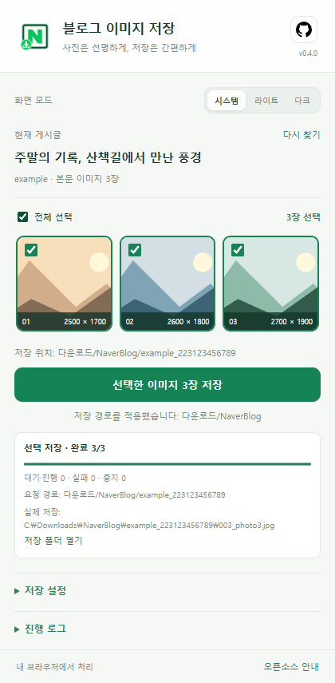
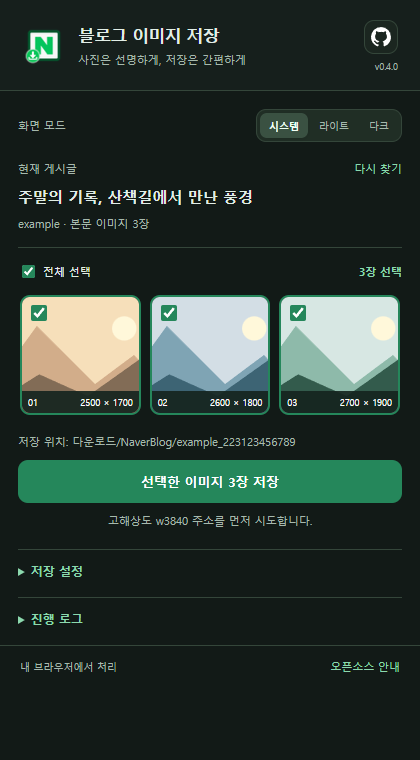

# 네이버 블로그 이미지 다운로더

네이버 블로그 **본문 사진을 미리보고, 원하는 사진만 골라 저장**하는 무료 오픈소스 Chrome 확장 프로그램입니다. 게시글을 열면 사진 목록을 찾고, **저장 버튼을 눌렀을 때만 다운로드**합니다.

**현재 버전: v0.4.0** · **데스크톱 Chrome 120 이상** · **Chrome 웹 스토어 미등록**

## 다운로드

**[v0.4.0 설치용 ZIP 다운로드](https://github.com/hsofficial/nblogdl-chrome/releases/latest/download/nblogdl-chrome-0.4.0.zip)**

[최신 릴리스 및 변경 안내](https://github.com/hsofficial/nblogdl-chrome/releases/latest) · [소스 코드](https://github.com/hsofficial/nblogdl-chrome)

처음 사용하신다면 설치용 ZIP을 받으시면 됩니다. 최신 버전이 바뀌어 위 파일 링크가 열리지 않으면 **최신 릴리스** 페이지에서 `nblogdl-chrome-버전.zip`을 선택해주세요. `Source code (zip)`은 개발용 전체 소스이며 폴더 구성이 다릅니다.

## 처음 설치하기

웹 스토어 등록 전이므로, ZIP을 풀어 Chrome의 **압축해제된 확장 프로그램 로드** 기능으로 설치합니다. Python, Node.js, npm, 별도 서버나 빌드는 필요하지 않습니다. 휴대폰 Chrome용 설치 안내가 아닙니다.

1. 위의 **설치용 ZIP 다운로드**를 눌러 파일을 받습니다.
2. ZIP을 마우스 오른쪽 버튼으로 눌러 **압축 풀기** 또는 **모두 추출**을 선택합니다. 압축을 푼 폴더는 앞으로도 사용할 위치에 보관해주세요. **설치 후에도 이 폴더를 삭제하거나 옮기지 마세요.**
3. Chrome 주소창에 `chrome://extensions`를 입력하고 Enter를 누릅니다.
4. 오른쪽 위 **개발자 모드**를 켭니다.
5. **압축해제된 확장 프로그램을 로드합니다** 또는 **압축해제된 확장 프로그램 로드** 버튼을 누릅니다. 영문 Chrome에서는 **Load unpacked**입니다.
6. 압축을 푼 폴더 중 **`manifest.json` 파일이 바로 보이는 폴더**를 선택합니다. ZIP 파일 자체를 선택하는 것이 아닙니다.
7. 목록에 **네이버 블로그 이미지 다운로더**, 버전 **0.4.0**이 표시되고 사용 스위치가 켜져 있는지 확인합니다.
8. 이미 열어둔 **네이버 블로그 게시글 탭을 새로고침**합니다.
9. Chrome 오른쪽 위 **확장 프로그램** 메뉴에서 이 확장의 **고정** 버튼을 누르면 도구 모음에서 쉽게 열 수 있습니다.

폴더 선택이 헷갈리면 다음 표를 확인해주세요.

| 받은 파일 | Chrome에서 선택할 폴더 |
| --- | --- |
| `nblogdl-chrome-0.4.0.zip` 설치용 ZIP | 압축을 푼 폴더. 바로 안에 `manifest.json`, `popup.html`, `background.js` 등이 있습니다. |
| GitHub의 `Source code (zip)` 또는 `Code → Download ZIP` | 압축을 푼 프로젝트 폴더 **안의 `extension/` 폴더**. 프로젝트 최상위에는 `manifest.json`이 없습니다. |

설치 절차는 [Google의 공식 압축해제 확장 설치 안내](https://developer.chrome.com/docs/extensions/get-started/tutorial/hello-world#load-unpacked)에서도 확인할 수 있습니다.

## 사용하기

1. `blog.naver.com` 또는 `m.blog.naver.com`의 **개별 게시글**을 엽니다.
2. 도구 모음에서 확장 아이콘을 누릅니다. 본문 사진과 선택 개수가 표시됩니다.
3. 사진의 체크 표시를 눌러 저장할 사진을 고릅니다. 처음 찾은 사진은 기본으로 선택되며, **전체 선택**으로 한 번에 바꿀 수 있습니다.
4. 필요하면 **저장 설정 → 하위 경로**를 바꿉니다.
5. **선택한 이미지 …장 저장**을 누릅니다. 진행 카드에서 완료·실패 상태를 확인하고, 필요하면 **중지**를 누릅니다.
6. 완료 카드의 **실제 저장** 경로와 **저장 폴더 열기**로 파일 위치를 확인합니다.

팝업을 닫아도 시작한 다운로드는 계속됩니다. 완료한 사진은 다시 저장할 수 있고, 현재 다운로드 중인 같은 사진은 중복으로 대기열에 넣지 않습니다. 사진이 늦게 나타나면 본문을 아래로 스크롤한 뒤 **다시 찾기**를 눌러주세요. 게시글을 열거나 **다시 찾기**를 누르는 것만으로 파일을 자동 저장하지는 않습니다.

### 화면 미리보기

| 라이트 모드 | 다크 모드 |
| --- | --- |
|  |  |

미리보기의 풍경은 화면 검증용 합성 이미지입니다.

### 어디에 저장되나요?

기준 위치는 **Chrome 설정에서 지정한 다운로드 폴더**입니다. 기본 하위 경로는 `NaverBlog`이며, 그 안에 게시글별 폴더를 만듭니다.

```text
Chrome 다운로드 폴더/
  NaverBlog/
    블로그ID_글번호/
      001_사진이름.jpg
      002_사진이름.jpg
```

- 하위 경로에 `사진/네이버`를 입력하면 `Chrome 다운로드 폴더/사진/네이버/블로그ID_글번호/`로 요청합니다.
- **상대 경로**만 사용할 수 있습니다. 드라이브 문자로 시작하는 절대 경로나 `..`는 사용할 수 없습니다.
- **설정 저장** 또는 Enter로 경로를 보존할 수 있습니다. 따로 저장하지 않아도 다운로드 버튼을 누른 순간의 입력값을 해당 작업에 적용합니다. 이미 시작한 작업의 경로는 바뀌지 않습니다.
- 파일명 앞에는 본문 순서 번호가 붙습니다. 같은 이름의 파일이 있으면 Chrome이 새 이름을 붙여 저장합니다.
- 화면의 **요청 경로**와 **실제 저장 경로**는 다를 수 있습니다. Chrome 저장 대화상자나 다른 다운로드 확장의 영향을 받았다면 완료 카드의 실제 경로를 확인해주세요. 경로 결정은 [Chrome downloads API](https://developer.chrome.com/docs/extensions/reference/api/downloads#event-onDeterminingFilename)를 따릅니다.

### 화질과 지원 범위

**고해상도 `w3840` 우선**으로 고정되어 있습니다. 해당 주소를 먼저 시도하고 네트워크·서버 오류가 발생하면 크기 옵션을 제거한 후보로 전환합니다. **작은 사진을 확대하거나 AI로 업스케일하는 기능은 없습니다.** 실제 크기는 업로드된 이미지와 네이버 서버 응답에 달려 있으므로, 가로 3840픽셀이나 최적 원본을 항상 보장하지 않습니다. 팝업의 크기 표시는 본문에서 얻은 정보이며 저장 파일을 검사한 결과가 아닙니다.

개별 게시글과 해당 본문 iframe에서 사진을 찾고, 명시적인 비사진 링크와 스티커는 제외합니다. 블로그 홈·목록 전체 수집, 비공개 글의 접근 제한 우회, 자동 스크롤은 지원하지 않습니다. 네이버 본문 구조, 지연 로딩, 같은 이미지의 중복 제거 때문에 뷰어 숫자와 항상 일치한다고 보장할 수는 없습니다.

### 화면 모드와 오픈소스 안내

- **시스템 / 라이트 / 다크** 중 선택할 수 있습니다. 기본값은 **시스템**이며 운영체제의 색상 설정을 따릅니다. 선택은 로컬에 저장되고 팝업과 안내 페이지에서 함께 사용합니다.
- 게시글 제목에 **아이유**가 포함되면 라임·라벤더 계열의 IU 응원봉 테마가 나타납니다. 다른 게시글에서는 기본 테마로 돌아오며, 라이트·다크 선택과 함께 동작합니다. 응원봉은 동봉한 SVG로 표시합니다.
- 헤더의 GitHub 아이콘은 [hsofficial 프로필](https://github.com/hsofficial)을 엽니다. **오픈소스 안내**는 새 탭에서 원본·참고 프로젝트, 라이선스, 동봉 GPLv3 전문을 보여줍니다.

## 잘 안 될 때

| 증상 | 확인할 내용 |
| --- | --- |
| 저장 버튼이 회색이거나 사진이 0장입니다. | 블로그 홈·검색 목록이 아닌 **개별 게시글 주소**인지 확인해주세요. `chrome://extensions`에서 확장을 새로고침한 뒤 **게시글 탭도 새로고침**하고 팝업을 다시 여세요. 사진을 하나 이상 선택해야 저장할 수 있습니다. |
| 사진이 일부만 보입니다. | 본문을 아래로 스크롤하여 늦게 불러오는 사진을 표시한 다음 **다시 찾기**를 누르세요. 접근할 수 없는 사진이나 바뀐 본문 구조는 수집되지 않을 수 있습니다. |
| 설치할 때 매니페스트를 찾을 수 없다고 나옵니다. | ZIP을 먼저 풀고, **바로 안에 `manifest.json`이 있는 폴더**를 선택하세요. 소스 코드 ZIP을 받았다면 `extension/`까지 들어가야 합니다. |
| 폴더를 옮기거나 지운 뒤 확장이 작동하지 않습니다. | Chrome은 설치 때 선택한 폴더의 파일을 계속 사용합니다. 가능하면 원래 위치에 복원한 뒤 확장을 새로고침하세요. 복원이 어렵다면 새 위치에서 다시 로드해야 하며 기존 설정이 이어지지 않을 수 있습니다. |
| 새 ZIP을 받았는데 이전 화면이나 버전이 나옵니다. | 다운로드만으로 설치된 소스가 바뀌지는 않습니다. **Chrome이 현재 로드한 폴더**의 파일을 새 버전으로 교체하고 확장과 게시글 탭을 모두 새로고침하세요. |
| 저장 위치가 예상과 다릅니다. | 완료 카드의 **실제 저장** 경로와 **저장 폴더 열기**를 확인하세요. Chrome 다운로드 위치, 저장 대화상자, 다른 다운로드 확장도 확인해주세요. |
| 다운로드 실패 또는 확인 필요 상태가 표시됩니다. | 인터넷 연결과 Chrome 다운로드 목록(`chrome://downloads`)을 확인하세요. 알려진 HTML·JSON 등의 오류 응답은 이 확장이 만든 파일임을 확인한 경우에만 정리하고 다음 후보를 시도합니다. 파일 종류가 불확실하면 자동 삭제하지 않고 확인 필요 상태로 남깁니다. |

계속 문제가 생기면 [Issues](https://github.com/hsofficial/nblogdl-chrome/issues)에 Chrome·확장 버전, 재현 절차, 오류 코드를 남겨주세요. 게시글 주소는 공개 가능한 경우에만 공유해주세요.

## 업데이트와 삭제

압축해제 방식은 **새 릴리스를 자동 설치하지 않습니다.**

1. [최신 릴리스](https://github.com/hsofficial/nblogdl-chrome/releases/latest)에서 설치용 ZIP을 받고 별도 위치에 압축을 풉니다.
2. 진행 중인 저장 작업을 마치거나 중지합니다.
3. **기존에 Chrome에서 로드한 폴더의 위치를 유지한 채** 그 안의 확장 파일을 새 버전 파일로 교체합니다. 새 폴더를 기존 폴더 안에 한 겹 더 넣지 말고, `manifest.json`이 같은 위치에 있도록 해주세요.
4. `chrome://extensions`에서 이 확장의 **새로고침** 버튼을 누르고 버전이 바뀌었는지 확인합니다.
5. 네이버 블로그 게시글 탭도 새로고침합니다.

기존 등록을 유지한 업데이트는 저장된 설정을 계속 사용합니다. 0.1.0에서 업데이트하면 당시의 자동 실행 설정·이력은 제거되고 남은 자동 작업은 중지됩니다. 현재 버전은 수동 저장만 제공합니다.

삭제하려면 먼저 진행 작업을 마치거나 중지한 뒤 `chrome://extensions`에서 이 확장의 **삭제**를 누르세요. 확장의 로컬 설정과 작업 기록은 삭제되지만 이미 내려받은 사진은 남습니다. 더 이상 사용하지 않는 설치 폴더와 ZIP은 직접 지우셔도 됩니다. 잠시 끄려면 삭제 대신 사용 스위치를 끄세요.

## 개인정보와 권한

처리 정보·보관·외부 요청·삭제 범위는 [개인정보처리방침](PRIVACY.md)에 정리했습니다. 웹스토어 등록용 문안과 규격 이미지는 [등록 준비 자료](store/README.md)를 확인해주세요. 자료 준비가 완료된 것과 웹스토어 심사 제출·승인은 별개이며, 현재 버전에는 제출 전 정리할 중복 권한이 있습니다.

**현재 v0.4.0 소스 기준으로 별도 수집 서버, 분석·광고 SDK, 외부 텔레메트리 전송 코드는 없습니다.** 사진 미리보기와 다운로드를 위해 네이버 이미지 서버에 요청하며, 사용자가 누른 GitHub·출처 링크는 해당 사이트를 엽니다. 네트워크 요청이 전혀 없는 도구라는 뜻은 아닙니다.

현재 탭에서 찾은 게시글 제목·주소·이미지 주소는 `chrome.storage.session`에 임시 보관합니다. 저장을 요청한 작업의 제목·주소·이미지 정보·실제 파일 경로·상태와 저장 설정은 `chrome.storage.local`에 보관합니다. 종료한 작업은 최근 30개, 진행 로그는 최근 60개를 유지합니다. 화면 모드도 로컬에 저장하며 `storage.sync`는 사용하지 않습니다. 로컬 저장소의 수명은 [Google storage API 문서](https://developer.chrome.com/docs/extensions/reference/api/storage)를 참고해주세요.

| 매니페스트 권한 | 사용 목적 |
| --- | --- |
| `storage` | 저장 경로·화면 모드·작업 상태 보존 및 탭별 수집 정보 임시 보관 |
| `downloads` | 사용자가 요청한 다운로드 시작·상태 확인·중지, 파일명 제안, 저장 위치 열기, 확인된 오류 응답 파일 정리 |
| `alarms` | 시작한 다운로드 대기열의 상태 확인과 서비스 워커 재시작 후 복구 |
| `activeTab` | v0.4.0에 남아 있는 선언입니다. 기본 탭 ID 조회·메시지 전달에는 필요하지 않아 웹스토어 제출 전 제거·검증 대상입니다. |
| `https://blog.naver.com/*`, `https://m.blog.naver.com/*` | 해당 네이버 블로그 페이지와 일치하는 본문 프레임에서 제목·사진 정보 읽기 |

실제 선언은 [`extension/manifest.json`](extension/manifest.json), 처리는 [`content.js`](extension/content.js), [`background.js`](extension/background.js), [`popup.js`](extension/popup.js), [`theme.js`](extension/theme.js)에서 확인할 수 있습니다.

## 개발 및 버전 이력

일반 사용자는 이 단계를 건너뛰셔도 됩니다. 개발자는 Node.js 환경에서 다음 명령을 사용합니다. 로직 테스트에는 추가 npm 패키지가 필요하지 않습니다.

```sh
npm test
npm run package
```

`npm run package`는 **PowerShell을 사용할 수 있는 환경**에서 `dist/nblogdl-chrome-0.4.0.zip`을 만듭니다. ZIP 최상위에 확장 파일이 들어가므로 압축을 푼 폴더를 바로 로드할 수 있습니다.

선택적인 GUI 검증은 `npm run smoke`입니다. 별도로 사용 가능한 **Playwright 패키지와 Chrome 실행 파일**이 필요합니다. 환경에 맞게 `PLAYWRIGHT_PATH`를 Playwright 패키지 경로로, `CHROME_PATH`를 Chrome 실행 파일 경로로 지정할 수 있습니다. 기본 Chrome 경로는 Windows 설치 위치를 사용합니다. 이 검증은 합성 이미지와 모의 Chrome API로 DOM·화면 동작을 확인하며, 설치된 확장에서 실제 네이버 사진을 내려받는 검증은 아닙니다. Playwright는 확장 배포 파일에 포함되지 않습니다.

- [CHANGELOG.md](CHANGELOG.md): 버전별 변경 사항
- [HISTORY.md](HISTORY.md): 보존된 버전 ZIP을 근거로 한 이력 복원 설명
- [RESEARCH_NOTES.md](RESEARCH_NOTES.md): 조사 근거, 구현·검증 기록 및 확인하지 못한 동작

공개 저장소의 초기 버전 이력은 **보존된 배포 ZIP을 바탕으로 복원한 체크포인트**입니다. 원래 Git 커밋은 존재하지 않았으며, 과거 커밋 시각이나 보존되지 않은 중간 편집 내용을 재현한 이력이 아닙니다.

## 라이선스와 출처

확장 소스는 **GNU GPL v3 (`GPL-3.0-only`)**로 제공합니다. 전문은 [`extension/LICENSE`](extension/LICENSE), 이식·변경 안내는 [`extension/NOTICE.txt`](extension/NOTICE.txt)에 있습니다. GitHub 마크 SVG는 **GitHub Inc.의 Primer Octicons, MIT 라이선스**이며 전문은 [`extension/icons/OCTICONS-LICENSE.txt`](extension/icons/OCTICONS-LICENSE.txt)에 동봉합니다. 설치용 ZIP에서는 같은 파일을 `icons/OCTICONS-LICENSE.txt`에서 찾을 수 있습니다.

- **hsofficial / HyeonSu Na**, 원본 참조 커밋 `0ebe1f83a9f6c8ae9cdbf72485f734c7472451bf`, 조사 기록 2026-10-14: [nblog-img-downloder](https://github.com/hsofficial/nblog-img-downloder/tree/0ebe1f83a9f6c8ae9cdbf72485f734c7472451bf). 본문 이미지 메타데이터와 `w3840` 주소 전략을 JavaScript로 재구현했습니다.
- **Mike Fährmann 및 gallery-dl 기여자**, 조사 기록 2026-10-14: [Naver Blog extractor](https://github.com/mikf/gallery-dl/blob/master/gallery_dl/extractor/naverblog.py). 주소 처리 전략을 비교 참고했으며 해당 코드·의존성은 동봉하지 않습니다.
- **Google**, 확인 2026-10-15: [확장 설치·새로고침 안내](https://developer.chrome.com/docs/extensions/get-started/tutorial/hello-world), [downloads API](https://developer.chrome.com/docs/extensions/reference/api/downloads), [storage API](https://developer.chrome.com/docs/extensions/reference/api/storage).
- **GitHub Inc.**, 동봉 출처 기록 2026-10-15: [Octicons GitHub 마크](https://github.com/primer/octicons/blob/main/icons/mark-github-16.svg), [MIT 라이선스](https://github.com/primer/octicons/blob/main/LICENSE).
- **사용자가 제공한 IU 응원봉 제품 이미지**, 디자인 참고 기록 2026-10-15: [참고 이미지](https://madeedtr4721.cdn-nhncommerce.com/data/editor/goods/220429/IKE_final_0427_133922.jpg). 형태·배색을 참고해 SVG와 CSS를 작성했으며 제품 사진은 확장 패키지에 동봉하지 않습니다.
